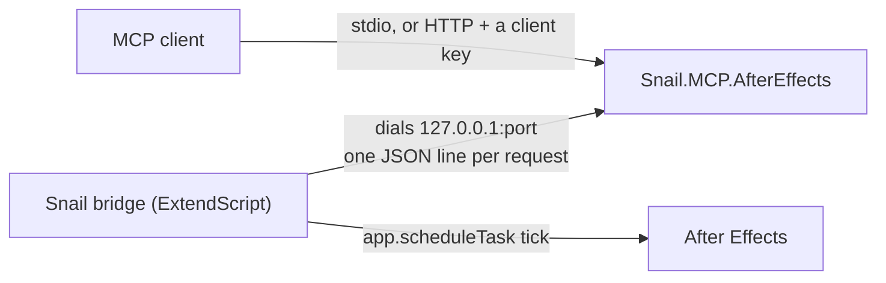

# Snail.MCP.AfterEffects

An MCP server that lets an AI agent drive a running Adobe After Effects: the project, compositions, layers, the property tree,
keyframes and expressions, text, shapes, effects, 3D, templates and rendering, reached through a small ExtendScript bridge inside
After Effects.

The server speaks MCP to the client and a one-line JSON protocol to the bridge. The bridge is a Startup script: it reads the
announcements the server leaves under `~/.s3l-mcp-aftereffects/state`, opens a connection to each server it finds, and serves the
requests on After Effects' main thread between the application's own work, each command in an undo group. It dials out because
ExtendScript cannot listen on macOS; [Architecture](architecture.md) explains the rest.

## Four layers of tools

1. **Always on** — the project, items and folders, compositions, layers of every kind, the property tree by match name, a frame as a
   picture, undo and redo, menu commands, skills and `find_tool`, and `ae_script` for the ExtendScript nothing else reaches.
2. **Skills** — `animation`, `text`, `shapes`, `effects`, `threed`, `compositing`, `rendering`, `farm`, `templates`, `transfer`, `layout`,
   `settings`, `viewer` and `workers`,
   loaded with `ae_enable_skill` and staying loaded until `ae_disable_skill`, or until unused for `SNAIL_MCP_AFTEREFFECTS_SKILL_IDLE_MINUTES`
   when that is set. Over HTTP every client that names itself has a tool list of its own. `find_tool` searches the whole catalog by what you
   are trying to do and answers with each tool's command and parameters.
3. **Sequences and programs** — `run_tools` sends a list of commands in one call; `run_program` runs a small JavaScript program that calls
   the commands itself, so a build of many steps costs one round trip.
4. **Scripts** — `ae_script` runs any ExtendScript inside After Effects; `SNAIL_MCP_AFTEREFFECTS_SCRIPTING=Off` switches it off.

## Quick start

1. Build the server and give your MCP client the command `dotnet` with the path to `Snail.MCP.AfterEffects.dll` — [Installation](installation.md).
2. In After Effects switch on *Allow Scripts to Write Files and Access Network*, once.
3. Ask the agent for `ae_install_bridge`, then `ae_diagnose`: once `afterEffects.reachable` is true, everything else works.

The [Tools](tools/index.md) pages are generated from the server itself: the names, descriptions and schemas are exactly what the model
receives in `tools/list`.
